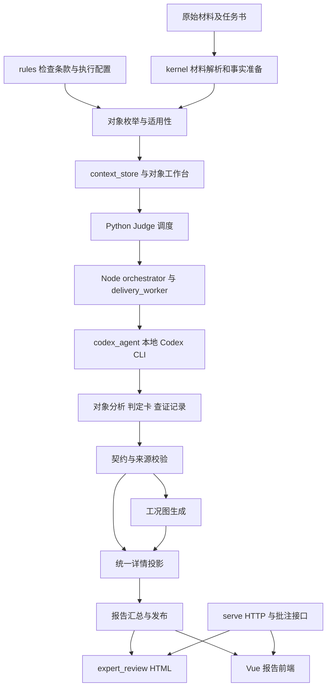

# 全局架构

本系统针对“板卡 × 检查项 × 对象”组织原理图评审。程序负责可重复的数据处理、执行和交付；Agent负责查证、建模、计算和电子判断。当前没有能够自动保证所有复杂分析收敛的独立技术裁决层。

## 分层与依赖

| 层 | 主实现 | 边界 |
|---|---|---|
| 材料事实 | [kernel](../../kernel)、[context_store.py](../../agent_review/context_store.py) | 保存来源、身份和连接事实，不预写电子答案 |
| 执行编排 | [run.py](../../agent_review/run.py)、[judge.py](../../agent_review/stages/judge.py) | 选范围、派任务、记录运行与恢复，不推断业务结论 |
| 模型推理 | [delivery_worker.mjs](../../agent_review/delivery_worker.mjs)、[prompts](../../agent_review/prompts) | 构建工程模型、计算并说明证据适用范围 |
| 契约校验 | [validate_job.py](../../agent_review/validate_job.py)、[decision_contract.py](../../agent_review/decision_contract.py) | 校验结构、引用和部分判定一致性；不能替代完整电气复核 |
| 图形与展示 | [stress_figures.py](../../agent_review/stress_figures.py)、[detail_view.py](../../agent_review/detail_view.py) | 叠绘与投影，不补造物理通路或结论 |

## 两条实际执行链

通用链由 `python -m agent_review.run` 组织 prep、enumerate、program、cases、calc、context_build、judge、stress_figures、aggregate、gate。阶段可按入口参数选择，不能据阶段名称推断每次都调用了Agent或完整求解。

本轮代表性交付由 [finish_selection_delivery.py](../../scripts/finish_selection_delivery.py) 等工具按板卡 `selection_delivery.json` 和任务队列定向执行。其 reconcile 路径重建目标对象工作台、复用待审分析并运行 delivery.v1；publish 路径检查源结果、汇总、绘图并发布。它依赖已准备材料，不等于重新执行通用链所有前置阶段。

## 实现与目标的区别

- 已有对象隔离、来源记录、精确签名、对象级保存、定向修复和两类图。
- 独立子Agent文档目前由当前协作过程定向引入，主模型核验采纳；不是每个对象自动必经的独立裁决服务。
- `incomplete_proof` 可以表示执行完成但证明未完成。不得把这种状态计作已经得到充分电气结论。
- 原始判定仍有新旧格式；统一的是 `detail.v2` 展示投影，尚未完成所有源卡迁移。
