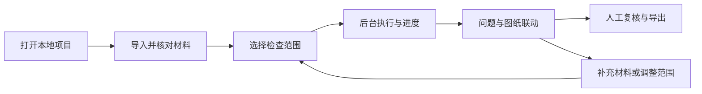
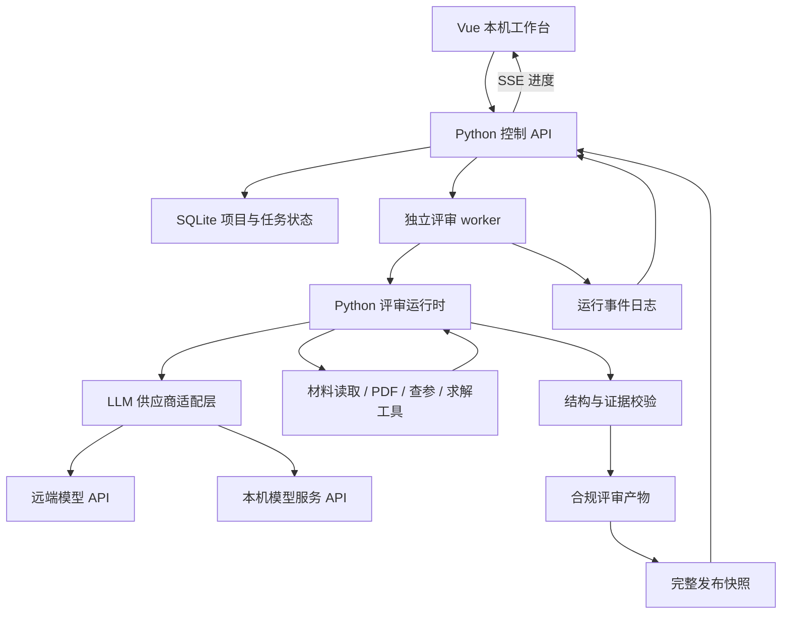

# 本机网页交互：竞品调研与开发方案

调研日期：2026-10-23。开发分支：`feat/web-review-workbench`。

用户已确认：浏览器操作，本机运行评审；评审后端直接基于 LLM API，不依赖 Codex CLI。本轮交付为调研与方案，文中新增页面、API、LLM 运行时和任务管理均为待开发。

## 1. 建议选择

推荐做 **本机评审工作台**：用上传/选择材料向导作为入口，用“问题清单—原理图—证据与分析”作为核心工作区，后续增加针对当前对象的问答。

先完成 LLM 接入和评审运行时迁移，再打通“选板 → 校验材料 → 选检查范围 → 后台执行 → 看进度 → 查看完整报告”，随后增加图纸联动、对象批注和历史比较。复用 Vue、Python 材料/求解/校验能力、PDF.js 和 `detail.v2` 展示契约；现有 Codex CLI 传输及其依赖需要迁移。

“本机运行”指网页服务、材料管理和任务调度在本机。模型可通过远端 LLM API 或本机模型服务接入，部署位置与模型供应商分开配置；远端模型和在线查参仍需要网络。

## 2. 竞品与可借鉴的交互

本次依据官方公开产品页和帮助文档，未登录竞品试用、未上传本项目材料。功能描述是公开资料事实；借鉴方式是针对本项目的设计建议。未独立验证厂商准确率、覆盖率和性能，不据此打分。

| 产品与关系 | 官方资料可确认的能力 | 本项目值得借鉴的方式 | 适用边界 |
|---|---|---|---|
| AllSpice / DRCY，直接参照 | 网页上传单版本或两个版本进行审查/差异查看；DRCY 后台运行，发现附带原理图位置与规格书引用 | 以一次评审组织问题；发现进入可追踪的人工复核流程；缺资料时提供补齐入口 | 公开资料不能证明完整支持本仓 `.eprj2/.tel` 及所有检查契约 |
| CADY，直接参照 | 导入网表和 BOM，启动自动分析，查看交互 HTML 报告；缺失规格书可补传 | 材料槽位、格式校验、识别结果预览、缺项提示，再开始评审 | CADY 的输入要求不能直接替代本项目六件套门禁；云端/混合方案也不等于本机全离线 |
| Altium 365 Design Reviews，审查流程参照 | 评审绑定设计快照，支持检查清单、图上评论、任务、审批及版本比较 | 评审必须绑定材料版本；图纸和问题能互相定位；复核结果可回溯 | 这是协同设计审查能力，不能据此认定有与本项目相同的 AI 电气判定能力；功能受方案授权影响 |
| Flux，AI 与画布交互参照 | 原理图可触发 AI design review；画布评论可定位、回复、解决；PCB 检查问题可携带上下文打开 AI 对话 | 从具体问题进入“解释此判定/检查此对象”的上下文问答，减少重复描述 | PCB DRC 与原理图电气深审不同；原生编辑器能力不应当成本项目现成能力 |
| CELUS Design Studio，相邻产品 | 功能块画布、错误/警告面板联动，Design Canvas、BOM、Output Files 分阶段呈现 | 错误列表点击后定位主图；前置材料满足后进入下一阶段 | 主要面向从需求生成设计，是交互参照，不是现有原理图审查的等价替代 |

来源与对应范围：

- AllSpice：[Quick Review](https://learn.allspice.io/docs/quick-review)、[DRCY AI Design Review](https://learn.allspice.io/docs/drcy-ai-design-review)。当前 [DRCY 产品页](https://allspice.io/drcy) 同时介绍 Reviews 和 Chat，不使用旧博客推断它没有聊天能力。
- CADY：[输入与使用指南](https://cadysolutions.com/how-to-use-cady/)、[FAQ](https://cadysolutions.com/faq/)。其 BOM 要求每个位号至少有一个制造商料号；公开指南列出 CSV/XLSX/XLS。此处仅描述竞品，未声称本项目支持相同导入格式。
- Altium：[Design Reviews](https://www.altium.com/documentation/altium-365/project-design-reviews)、[Web Viewer](https://www.altium.com/documentation/altium-365/viewers/web-viewer)。分别支持快照/清单/复核流程和浏览器图纸交互的描述。
- Flux：[原理图入门中的 Design Review](https://docs.flux.ai/Introduction/getting-started-in-flux--schematic)、[Comments](https://docs.flux.ai/reference/reference-comments)、[PCB Design Reviews](https://docs.flux.ai/flux/tutorials/pcb-design-review)。最后一项用于借鉴“带检查上下文问 AI”，不作为原理图自动审查覆盖率证据。
- CELUS：[Design Canvas](https://www.celus.io/knowledge/design-canvas)。

共同启发是：把“发现问题、定位证据、作出处理、复跑验证”组织成连续操作；结果列表和聊天入口都要指向明确的材料与对象。

## 3. 三种产品方案

| 方案 | 用户怎么用 | 优点 | 主要新增工作与局限 | 建议 |
|---|---|---|---|---|
| A：流程控制台 | 选材料 → 选规则 → 启动 → 看阶段进度 → 打开报告 | 最小网页操作闭环，适合先验证 LLM 评审链路 | 三种方案均先需要直接 LLM 接入；本方案另需任务 API、后台执行和持久状态，分析与图纸仍会频繁切换 | 作为首个网页迭代 |
| B：评审工作台 | 左侧筛选问题，中间查看图纸，右侧核对证据、分析与复核记录 | 贴近工程师审查动作，适合大量对象反复核对 | 在 A 基础上增加定位、对象级反馈、批次快照和布局联动 | 推荐最终主界面 |
| C：对话助手 | 输入“解释这个问题”或“重新检查某对象”，在对话中查看任务与结果 | 适合追问和表达局部意图 | 需要意图转结构化范围、上下文引用、任务确认及独立记录；纯聊天不易看清全板覆盖 | 后续作为 B 的辅助抽屉 |

实现顺序为 LLM 基础迁移 → A → B → C。这里是相对工程范围判断，不是固定工期承诺。

首版的稳定入口是规则范围。通用 `agent_review.run` 尚无统一任意对象筛选参数；“只复核 R38”需要单独设计通用范围适配，不能直接把现有 P11 专用脚本包装成所有规则的对象接口。

## 4. 推荐页面与操作

### 4.1 主流程



| 页面 | 用户需要看到与完成的事 |
|---|---|
| 项目列表 | 选择已有板卡或新建项目；显示最近一次完整报告与正在执行的任务；提供打开 `0918全量` 示例入口 |
| 材料准备 | 以文件角色展示原理图 PDF、网表、BOM、工程文件、工况及任务书等；按当前材料契约校验；展示识别数量、缺项和材料版本 |
| 启动评审 | 选择全量或规则子集；展示适用对象数量与本次覆盖；高级设置折叠显示并发、续跑与执行配置 |
| 运行进度 | 显示当前阶段、已完成/待处理对象、最近事件、开始时间、失败原因；提供停止及完成后查看报告 |
| 评审工作台 | 按规则、对象、结论、人工复核状态过滤；点击问题定位原理图并加载统一分析详情；可标记复核意见 |
| 历史与导出 | 打开某一次完整报告；比较规则/对象结论变化；导出已有报告包。图纸几何差异比较留到后续 |
| 模型设置 | 配置模型服务、接口地址、模型及凭据引用；测试连接和所需能力；设置超时、并发和用量上限。密钥由后端保存，不随报告或浏览器请求日志回传 |

大屏工作区布局建议：

```text
项目 / 材料版本 / 评审批次                 运行状态  新建评审  导出
┌────────────────┬────────────────────────┬─────────────────────┐
│ 问题清单       │ 原理图 PDF             │ 当前对象            │
│ 规则/对象搜索  │ 页码、缩放、搜索        │ 工程判定            │
│ 结论/复核筛选  │ 已有定位数据对应的标记  │ 材料与分析思路      │
│ 问题及摘要     │                        │ 判定依据与来源      │
│                │                        │ 人工复核与补充意见  │
└────────────────┴────────────────────────┴─────────────────────┘
```

窄屏切换为问题、图纸、详情三个标签，保留当前对象。PDF 没有可靠对象坐标时显示“第 N 页”，不伪造器件级定位。优先复用现有 PDF.js、图幅资源和工况图。

交互约定：

- 结论使用“通过 / 不通过 / 待确认 / 不适用”，同时保留颜色和文字；人工复核状态另列为“未复核 / 已确认 / 有异议”。
- 进度显示阶段与实际完成数量；总数尚未枚举时显示“正在识别范围”，不估造百分比或剩余时间。
- 机器“分析思路”继续使用统一 `detail.v2` 投影；不由前端拼出新推理，也不恢复独立的“成立前提 / 判断思路”区块。
- 解释、引用、批注都绑定当前对象和评审批次。人工意见独立保存，不能直接改原判定卡。
- 文件上传成功、材料解析成功、任务执行完成、结果校验通过、报告发布完成分别反馈。
- 先使用中文系统字体、清晰分栏、可见键盘焦点和正文对比度；沿用现有 Element Plus 主体，按实际使用整理双组件库依赖。

UI/UX Pro Max 检索命中了多步进度反馈及 Vue 状态管理建议；两次整体风格检索偏营销页面，不适用于工程审查工作区。因此未保存其自动生成配色/字体方案，上述布局是基于本项目操作任务和通用可访问性原则的设计判断。

## 5. 当前能力与缺口

| 范围 | 当前代码证据 | 网页交互需要增加 |
|---|---|---|
| 报告浏览 | [router.js](../report_ui/src/router.js)、[RuleList.vue](../report_ui/src/views/RuleList.vue)、[RuleDetail.vue](../report_ui/src/views/RuleDetail.vue) | 当前仅规则列表、详情；新增项目、材料、运行、历史入口 |
| HTTP 服务 | [serve.py](../agent_review/serve.py) | 当前主要是静态资源与规则级批注；新增上传、任务调度及状态接口 |
| 执行流程 | [run.py](../agent_review/run.py) | 复用规则选择、阶段、并发和续跑；通过受控 API 调用，不能让浏览器提交任意 shell 命令 |
| 模型执行 | [codex_agent.mjs](../agent_review/codex_agent.mjs)、[delivery_worker.mjs](../agent_review/delivery_worker.mjs)、[evidence_worker.mjs](../agent_review/evidence_worker.mjs) | 当前借助 CLI 获得会话、读文件、查证和产物写入；目标由 Python LLM 运行时、模型适配器和受控工具替代 |
| 进度 | [orchestrator.mjs](../agent_review/orchestrator.mjs)、[delivery_progress.py](../agent_review/delivery_progress.py) | 现有阶段事件、对象记录要适配为统一运行事件；末尾才写入的 `agent_review_state.json` 不能充当实时心跳 |
| 续跑 | [judge.py](../agent_review/stages/judge.py)、[execution_policy.py](../agent_review/execution_policy.py) | 调用已有契约和签名检查；解释哪些对象可复用、哪些必须重跑 |
| 材料复用 | [prep.py](../agent_review/stages/prep.py) | 目前存在 KG/材料文件便可能直接复用；导入新材料必须触发正常重建及旧上下文失效 |
| 发布与历史 | [aggregate.py](../agent_review/aggregate.py)、[expert_report.py](../agent_review/expert_report.py) | 当前 `review_out` 是可变目录；增加完整发布快照和版本指针，避免运行中混读新旧文件 |
| 停止 | [codex_agent.mjs](../agent_review/codex_agent.mjs) | 现有 CLI 进程取消不能直接复用为 API 取消；需终止本地请求/工具任务、停止后续调度并收敛任务状态。远端推理是否停止取决于服务能力 |
| 复核意见 | [serve.py](../agent_review/serve.py) 的 `/api/feedback` | 当前 Vue 未接入；需要按运行/规则/对象保存，避免规则级整张 map 覆盖 |

## 6. 本机技术方案

目标为 **Vue + Python FastAPI 控制层 + Python LLM 评审运行时 + 独立 worker + SQLite 任务元数据**。后端直接通过模型 API 执行推理，由应用组织材料、调用工具和保存结果。Node 保留给前端构建及仍需要它的工程文件解析工具，不作为模型接入的必经层。

大型评审不放在 HTTP 请求里同步等待；FastAPI 的 BackgroundTasks 也不作为持久任务队列。独立 worker 的选择来自本项目长时间执行、停止和恢复需求；[FastAPI 官方说明](https://fastapi.tiangolo.com/tutorial/background-tasks/) 也区分了轻量后台任务与重计算需求。



SSE 负责服务端向浏览器推送阶段事件，启动、停止、反馈仍使用普通 HTTP 请求。SSE 是单向事件流，其浏览器行为见 [MDN](https://developer.mozilla.org/en-US/docs/Web/API/Server-sent_events/Using_server-sent_events)。服务端仍需保存事件序号和历史，重连时补发，不能仅依赖连接本身保存进度。

### 6.1 直接 LLM 接入与职责

LLM 接口只负责接收内容并返回生成结果或工具调用。当前 CLI 自动承担的工作，需要应用明确接管，不能仅把 `spawn(codex)` 换成一条聊天请求。工具调用的典型机制是模型返回结构化调用，由应用执行并回传结果，见 [Claude 官方工具说明](https://platform.claude.com/docs/en/agents-and-tools/tool-use/overview)；本项目采用供应商无关的应用契约。

| 层 | 目标职责 |
|---|---|
| `LLMClient` / 模型适配器 | 统一消息、内容块、工具调用、结构化输出、流事件、用量和错误；屏蔽各供应商 API 差异 |
| 评审运行时 | 按规则驱动分析、自检、结构化交付及有限修复；管理轮次、超时、调用预算和持久化状态 |
| 上下文构建 | 将实际材料片段、页图及来源标识传给模型；本地路径只是定位信息，不能指望远端 API 自动读取本地文件 |
| 工具注册表 | 提供读取已授权材料、PDF 页提取、查询网络/引脚、搜索与获取规格书、调用求解器等明确工具；工具结果保存来源和哈希 |
| 结果写入与校验 | 应用接收结构化结果，校验字段、证据、引用及工程契约，通过后原子写入约定产物；模型不直接改正式目录 |
| 运行记录 | 应用拥有 `run_id`、轮次消息、工具回执、展示用分析、输出及用量；供应商响应 ID 作为辅助记录，不充当通用续跑条件 |

模型配置至少包含供应商/协议、`base_url`、`model`、凭据引用、超时、并发及调用预算。使用 profile 分别指定深审、证据研究、文案等任务的模型；默认引用应用的统一配置，不继承 Codex 登录态或配置文件，不硬编码模型名。配置变化进入执行签名，使旧断点按策略失效；凭据内容不进入报告和执行签名。

能力预检包括工具调用、结构化输出、图像输入、流式响应及上下文容量。兼容某种 HTTP 协议不代表具备全部能力；缺少任务所需能力时给出具体阻塞原因。供应商未返回用量时记为未知，不伪造为零；必要时以请求/轮次上限提供可执行的预算约束。

接入选择：

| 方式 | 用途与取舍 | 建议 |
|---|---|---|
| 应用接口 + 首个直接 API 适配器 | 范围小、行为可测；以后按同一应用契约扩展供应商 | 首版采用，首个服务按实际配置确定 |
| 适配器内部使用 LiteLLM | 官方提供统一 Python 调用接口，可减少多供应商接入工作；仍需自行验证工具/结构化/图像能力差异 | 同时接多个服务时评估，不要求另部署网关；[官方文档](https://docs.litellm.ai/docs/) |
| 本机模型 API，例如 Ollama | 与同一本机工作台对接；模型、硬件和任务质量需要独立验证 | 作为可选部署方式；[Ollama 官方 API](https://docs.ollama.com/api/introduction) 区分本机与云端地址 |

首个迁移切片选择报告文案，验证纯结构化输入/输出；随后迁移单对象评审与工具循环，再接证据研究、参数提取、路径草案和整改建议。文案调用成功只证明传输与该任务可用，不能视为整套深审完成迁移。

迁移范围覆盖 `orchestrator.mjs` 及 delivery/evidence/detail_prose/remediation 等 worker、调用它们的 Python 入口、依赖 CLI 文件操作的提示词、来源与运行元数据验证、执行签名和冒烟测试。保留已有业务 Schema、证据校验和正常发布链路，逐项验证语义一致性。新网页链路验收要求未安装 Codex CLI 时仍可完成所选范围，不用静默回退到 CLI 掩盖缺失功能。

### 6.2 本机运行约束

1. 服务默认监听 `127.0.0.1`，前后端同源；新增可执行操作后收紧现有 `CORS: *`。材料由本地文件选择/导入进入受控目录。
2. 初期全局串行板级任务、同板单写入锁；对象内并发沿用配置。SQLite 保存项目、材料版本、运行、事件和人工反馈，原始材料与大文件继续留在本地文件系统。
3. 每次运行记录 `run_id`、父运行、材料清单/哈希、规则范围、执行配置、开始/结束时间及发布状态。新材料版本通过正常准备流程重建，不直接编辑知识图或判定卡。
4. 刷新或关闭浏览器不影响 worker。服务/worker 重启后核对进程与心跳，无法确认存活的任务标为“已中断”；续跑创建关联的新 attempt，按现有校验决定复用。
5. “停止”先进入 stopping，取消本地模型请求和工具执行、停止后续派发，收集有效检查点并确认本地 worker 收敛；迟到响应不得覆盖已结束运行。已发送的远端请求是否继续执行或计费取决于供应商。暂不承诺任意时刻暂停后从同一条指令继续。
6. 完整报告经过生成与校验后，保存到不可变发布快照并切换指针。运行中默认查看上一个完整版本，当前任务另页显示进度；部分结果明确标记未发布。
7. UI 的“材料检查 / 程序检查 / AI 深审”需要明确执行映射；现有 `--dry-run` 可能在查参和报告文案阶段联网，不能直接作为“离线模式”。
8. 运行环境检测分为本地解析/求解依赖与 LLM 服务连接/能力。迁移完成后的网页链路移除 Codex 可执行路径、登录检测和 `LOCALAPPDATA` 查找，所有模型由应用配置注入。

建议 API（均为待实现）：

| 接口 | 用途 |
|---|---|
| `GET /api/runtime` | 本地解析/求解环境及已配置的模型服务状态，仅返回必要状态 |
| `GET/PUT /api/model-profiles` | 读取脱敏配置、更新服务地址/模型/凭据引用 |
| `POST /api/model-profiles/{id}/test` | 显式测试连接及任务所需能力，记录真实测试结果 |
| `GET/POST /api/boards` | 列出/创建本地项目 |
| `GET/POST /api/boards/{id}/materials` | 材料清单、导入和角色映射 |
| `POST /api/boards/{id}/preflight` | 执行所选范围的材料和环境预检 |
| `POST /api/boards/{id}/runs` | 按固定请求模型创建评审任务 |
| `GET /api/runs/{id}`、`GET /api/runs/{id}/events` | 状态和事件流 |
| `POST /api/runs/{id}/stop`、`POST /api/runs/{id}/resume` | 停止与创建续跑 attempt |
| `GET /api/boards/{id}/reports/{runId}` | 完整报告及版本内资源索引 |
| `PUT /api/reviews/{runId}/{ruleId}/{objectId}/feedback` | 对象级复核意见，与机器结论分开 |

状态拆分：执行为 queued/running/stopping/stopped/interrupted/failed/completed；交付为 pending/generated/validated/invalid；工程结论为通过/不通过/待确认/不适用；报告发布另记 pending/published/failed。“执行完成且结论不通过”是正常业务结果。

## 7. 分阶段开发与验收

| 阶段 | 开发内容 | 可直接验收的结果 |
|---|---|---|
| L0：LLM 接入与运行时 | 模型适配器、上下文传递、工具循环、结构化输出、签名/用量/取消与恢复；先文案再单对象深审，再覆盖其余模型调用入口 | 无 Codex CLI 的环境下生成合规文案并完成至少一个真实对象的证据获取、分析、自检、交付和校验；其余未迁移任务明确不可用 |
| P0：打通运行闭环 | 模型服务设置、环境检测、已有板选择、材料预检、规则范围、后台任务、事件、停止/续跑、完整报告入口 | 在网页运行 `0918全量` 的 P05-A01，显示 51 个对象及真实结论，再验证一项已迁移的 LLM 深审；刷新后任务仍可追踪；重复启动不会产生同板并行写入 |
| P1：形成日常工作台 | 新项目材料导入、材料版本重建、三栏联动、对象筛选与复核、历史报告、结果差异 | 更换材料不误复用旧 KG；点击对象定位到可靠图幅；人工意见不改机器结论；旧报告在新任务失败时仍完整可读 |
| P2：对象问答与定向复核 | 当前对象问答、带来源回答、通用对象范围适配、补证后定向复跑 | 问答绑定材料/结果版本；每次执行都能看见确定范围；建议经过正常任务和校验才能进入正式结果 |

首轮回归先覆盖 LLM 层：工具参数校验、缺失来源、结构化结果失败、请求限流/超时、有限重试、停止后的迟到响应、模型/工具变化导致断点失效、无 CLI 环境的真实接入。然后覆盖控制层的重复请求、进程退出、服务重启、SSE 重连、材料版本失效、发布原子性和批注隔离。真实模型测试与模拟协议测试分开记录；涉及现有流水线实现时按 `AGENTS.md` 运行对应逻辑与迁移验证，不能用修改基线隐藏行为变化。产品规划文档本身不触发模型评审。

本轮暂不包含在线绘制/修改原理图、PCB 自动布局、多租户账号、团队审批或任意 EDA 格式兼容。上述能力需要独立范围和验证。


## 8. 分支实现与验收状态（2026-10-23）

本机工作台已实现材料导入、预检、规则与对象范围、持久任务、事件流、停止/续跑、不可变报告快照、三栏报告、反馈、历史比较、导出、模型设置、对象问答和定向复核。活跃 Python 模型入口已迁移为直接 LLM API；旧 worker 不再参与网页执行。

P05-A01 已在真实材料上完成 51 个对象的程序检查并通过报告门禁，网页已验证 PDF 页定位、筛选、反馈刷新保存、版本比较和移动端布局。原程序/求解迁移基线保持一致；新增协议测试使用模拟服务，真实模型验收必须另记。

尚待验收：配置首个真实 LLM 服务，完成至少一个对象的查证、分析、自检、工程契约交付、报告文案与带来源追问。服务地址、模型名和凭据未配置时不声明 L0/P0 的真实深审验收完成。
